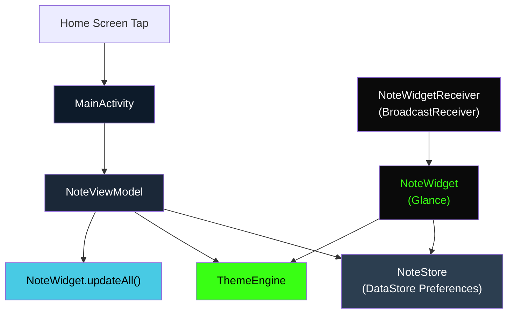
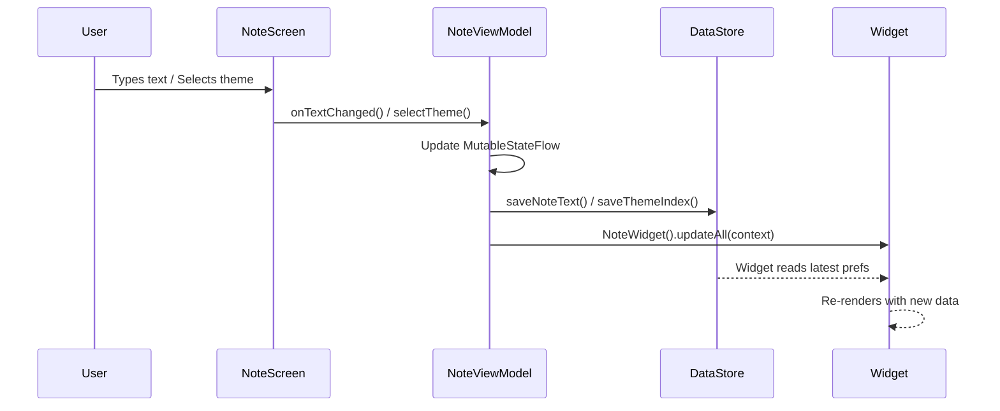

# Typo Poster — Architecture & Implementation Guide

> A typographic poster-style note-taking app with a live home screen widget.

---

## Project Architecture



## State Management



**Approach:** Unidirectional data flow via `StateFlow`. The `NoteViewModel` is the single owner of `NoteUiState`. All mutations flow through the ViewModel, which persists to DataStore and triggers widget refresh in one atomic operation.

---

## File Map (10 source files)

| Layer | File | Purpose |
|-------|------|---------|
| **Entry** | `MainActivity.kt` | Edge-to-edge Compose host, keyboard auto-focus |
| **App** | `TypoPosterApp.kt` | Application class, initializes NoteStore |
| **Theme** | `ThemeEngine.kt` | 3 predefined `PosterTheme` objects with fonts, colors, weights |
| **Data** | `NoteStore.kt` | DataStore Preferences wrapper (text + theme index) |
| **UI** | `NoteScreen.kt` | Distraction-free editor with auto-scaling typography |
| **UI** | `NoteViewModel.kt` | `NoteUiState` StateFlow + widget refresh logic |
| **UI** | `ThemePickerSheet.kt` | Modal bottom sheet with live theme preview cards |
| **Widget** | `NoteWidget.kt` | Jetpack Glance responsive widget with 4 size breakpoints |
| **Widget** | `NoteWidgetReceiver.kt` | BroadcastReceiver for `APPWIDGET_UPDATE` |
| **Config** | `note_widget_info.xml` | Widget metadata (sizing, resize, update interval) |

---

## Theme Engine — 3 Visual Skins

### Theme 1: The Executive
| Property | Value |
|----------|-------|
| Background | `#0A0A0A` (deep matte black) |
| Text | `#F0F0F0` (soft white) |
| Accent | `#39FF14` (electric green) |
| Header Font | **Inter** SemiBold |
| Body Font | **Roboto Mono** Regular |

### Theme 2: The Editorial
| Property | Value |
|----------|-------|
| Background | `#FAF7F2` (warm off-white) |
| Text | `#2C2C2C` (charcoal) |
| Accent | `#B8392F` (editorial red) |
| Header Font | **Playfair Display** Bold |
| Body Font | **Lora** Regular |

### Theme 3: The Blueprint
| Property | Value |
|----------|-------|
| Background | `#0D1B2A` (navy blue) |
| Text | `#FFFFFF` (crisp white) |
| Accent | `#48CAE4` (cyan) |
| Header Font | **Montserrat** Bold |
| Body Font | **Montserrat** Light |

---

## Widget — Responsive Auto-Scaling

The widget uses **Jetpack Glance** with `SizeMode.Responsive` across 4 breakpoints:

| Breakpoint | Min Size | Font Size | Max Lines |
|------------|----------|-----------|-----------|
| Small | 180×80 dp | 13 sp | 3 |
| Medium | 250×110 dp | 15 sp | 4 |
| Large | 320×200 dp | 18 sp | 8 |
| Extra Large | 400×300 dp | 22 sp | 14 |

**Content-aware scaling:** Font size further reduces by 8–25% for longer text (60+ characters) to maintain visual balance.

> [!IMPORTANT]
> The widget refreshes **immediately** when text or theme changes via `NoteWidget().updateAll(context)` called from the ViewModel after every DataStore write.

---

## Auto-Fit Typography (In-App)

The editor dynamically adjusts font size and line height based on character count:

| Characters | Font Size | Line Height | Weight |
|------------|-----------|-------------|--------|
| ≤ 20 | 28 sp | 40 sp | Medium |
| 21–50 | 24 sp | 36 sp | Medium |
| 51–120 | 20 sp | 30 sp | Normal |
| 121–250 | 17 sp | 26 sp | Normal |
| 250+ | 15 sp | 23 sp | Normal |

Short notes render as bold poster-style headlines. Longer notes gracefully scale into comfortable reading typography.

---

## Key Design Decisions

1. **No Room database** — A single-document app with two fields (text + theme index) is perfectly served by DataStore Preferences. Zero migration headaches.

2. **No navigation framework** — One screen, one purpose. The bottom sheet is a composable overlay, not a destination.

3. **Animated theme transitions** — `animateColorAsState` with 400ms tween on background, text, and accent colors creates smooth cross-fades between themes.

4. **Edge-to-edge rendering** — `enableEdgeToEdge()` + `systemBarsPadding()` for immersive typography that extends behind system bars.

5. **Widget → App launch** — `actionStartActivity<MainActivity>()` in Glance opens the app. The activity detects non-launcher intents and auto-focuses the keyboard.

---

## Multi-Note & Multiple Widget Architecture

```mermaid
graph TD
    A["Home Screen: Widget 1 (Work)"] -->|Taps| M["MainActivity (Opens Work Note)"]
    B["Home Screen: Widget 2 (Ideas)"] -->|Taps| M
    C["Home Screen: Widget 3 (Daily)"] -->|Taps| M
    
    WCA["WidgetConfigureActivity"] -->|Assigns Note ID| GState["Glance Widget Preferences"]
    
    M --> VM["NoteViewModel"]
    VM -->|Saves Note| NS["NoteStore (DataStore)"]
    VM -->|Immediate Push| NW["NoteWidget.updateWidgetForNote()"]
    NW -->|updateAppWidgetState + update()| GState
    GState -->|Instant RemoteViews Refresh| A
    GState -->|Instant RemoteViews Refresh| B
    GState -->|Instant RemoteViews Refresh| C
```

### Key Enhancements

1. **Immediate Real-Time Updates (No Tap Needed):**
   - Implemented `PreferencesGlanceStateDefinition` directly on `NoteWidget`.
   - On every keystroke or theme change in the app, `NoteViewModel` pushes an update to `updateAppWidgetState` and triggers `NoteWidget().update(context, glanceId)`.
   - Android OS re-renders the home screen widget in real time without waiting for any user interaction.

2. **Multiple Notes & Multiple Widgets:**
   - Added `WidgetConfigureActivity` (`APPWIDGET_CONFIGURE`): when you drag a new widget to your home screen, an assignment screen appears letting you pick which note to bind to this widget (e.g., Work, Ideas, Gym, Focus) or create a new note on the spot.
   - Each widget displays its own note, title, and theme independently.
   - Tapping any widget on your home screen launches the app directly into that specific note with keyboard auto-focused.

3. **In-App Note Switcher:**
   - Minimalist horizontal tabs at the top (`NOTE 1`, `NOTE 2`, `+`).
   - Tap any tab to switch notes.
   - Long-press or tap title to rename or delete notes.
   - Each note keeps its own independent visual theme!

4. **Direct 1-Tap "Add to Widget" Button:**
   - Directly in the app top bar (`+ WIDGET` button) and inside the note options dialog (`📌 Add Widget to Home Screen`).
   - Uses Android's native `AppWidgetManager.requestPinAppWidget()` paired with `PinWidgetReceiver`.
   - Automatically opens the OS "Add to Home Screen" prompt with the note pre-bound.
   - You no longer have to manually search through widget pickers on your launcher!

5. **Rich Typography Formatting Engine:**
   - **Formatting Toolbar:** Floating pill docked neatly above the bottom bar with:
     - **`B`** (Bold)
     - *`I`* (Italics)
     - 🟡 **Acid Lime** (`#D6F928` / `#38450A`) — vibrant neon highlighter
     - 🟠 **Sunset Coral** (`#FF9E7D` / `#4A1B14`) — warm punchy peach
     - 🔵 **Cyber Sky** (`#64E9EE` / `#0E3A42`) — crisp electric sky mint
     - 🟣 **Deep Plum** (`#801B53` / `#4D0E30`) — rich velvety darker shade
     - 🟢 **Forest Pine** (`#185338` / `#0C2B1D`) — deep emerald darker shade
     - **✕** (Clear formatting)
   - **Pure Text Highlighting (No Heading Bullets):** Zero bullet symbols or heading prefixes (`✦`, `◆`, `●` removed). It is purely an inline highlighter pen marking the exact words selected.
   - **In-App Editor:** Uses `RichTextVisualTransformation` to apply `SpanStyle(background = ...)` and `SpanStyle(fontWeight / fontStyle)`. Tags (`**`, `*`, `[h1]`..`[h5]`) are quietly dimmed so typing and cursor navigation remain 100% fluid.
   - **Home Screen Widget:** Built with `AndroidRemoteViews` running an active `SpannableStringBuilder` with native `BackgroundColorSpan`, `StyleSpan(Typeface.BOLD)`, and `StyleSpan(Typeface.ITALIC)`. Formatted text appears on your home screen with authentic highlighter backgrounds and bold/italic styling!

```bash
# Open in Android Studio
# Or build from command line:
cd ~/TypoPosterApp
./gradlew assembleDebug

# Install on connected device
./gradlew installDebug
```

> [!TIP]
> After installing, long-press the home screen → Widgets → find **Typo Poster** → drag to home screen. The widget syncs instantly with any text or theme changes made in the app.
